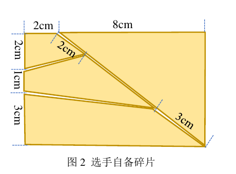

# 题目与约束

## 题目是什么

本题是视觉引导的碎片搬运与拼接：识别纵向 A4 纸上半区域的碎片，将它们移到下半区域组成矩形。机械臂或其他机构均可；写字机式平台是实现选择，不是题目指定装置，也不是传统七块七巧板。

## 官方约束整理（S1，第1—2页）

- 自备纸张和四片碎片均为纯色，四片同色，颜色自选；厚度不超过 2 mm，碎片上不装元器件。
- 纸面上下区有明显分界，实线宽度不超过 5 mm。
- 现场碎片最多四片，每片最多五条边，边长至少 2 cm；每片至少一边属于目标矩形外边。
- 现场材料为约 0.3 mm 镀锌薄铁片上贴纸，总厚度不超过 2 mm、重量不超过 30 g；目标矩形范围为 9×5 cm 至 12×9 cm。
- 现场纸面分别采用白色和白底扑克牌图案。扑克牌任务还要求拼接花纹对应。

## 自备几何

图片来源：S1 第2页图2。外框由图中尺寸得出为 10×6 cm；图内斜边标注不可用像素比例替代。制作前根据原图建立几何模型，检查边长和面积闭合。

## 阅读边界

此处以江苏发布版为准；学校或其他赛区的补充说明须单独核对。没有证据表明题面强制某款 MCU、深度学习或固定机械结构。

---

证据索引：[S1—S10](../../../../docs/sources.md)。除明确标为官方要求或接口行为的部分，其余为工程建议；尚未实机验证。
